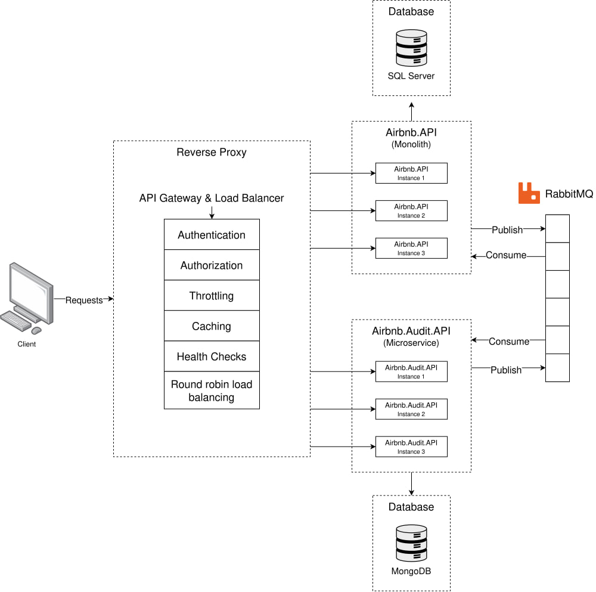
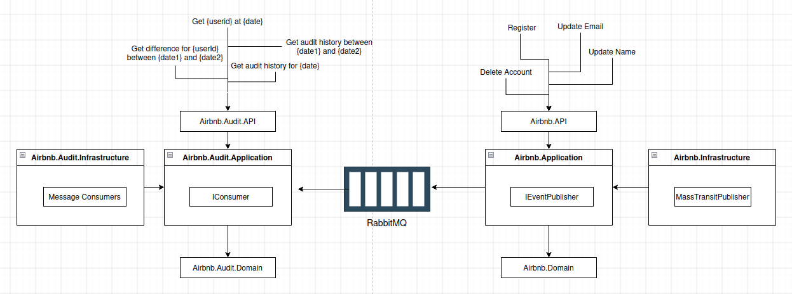
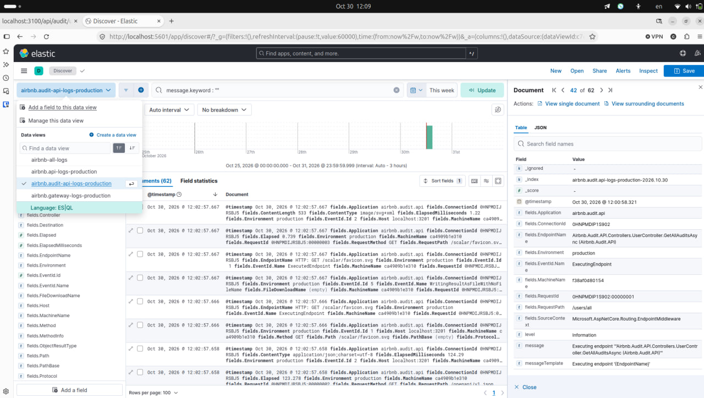
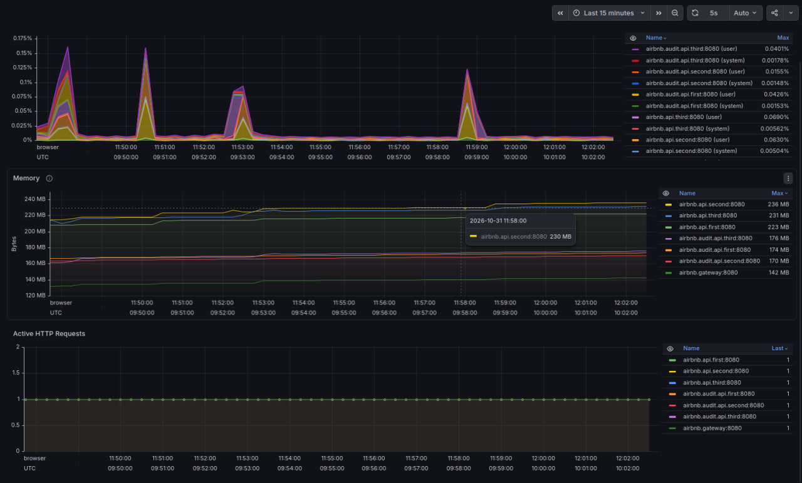
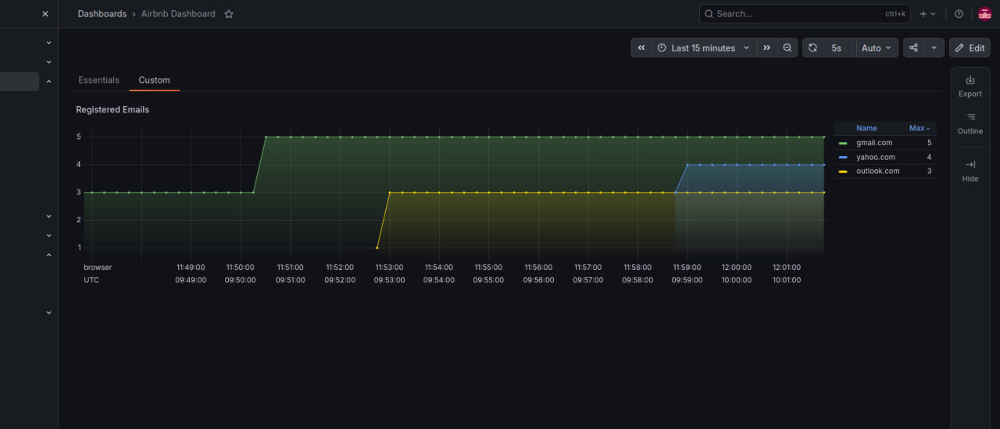
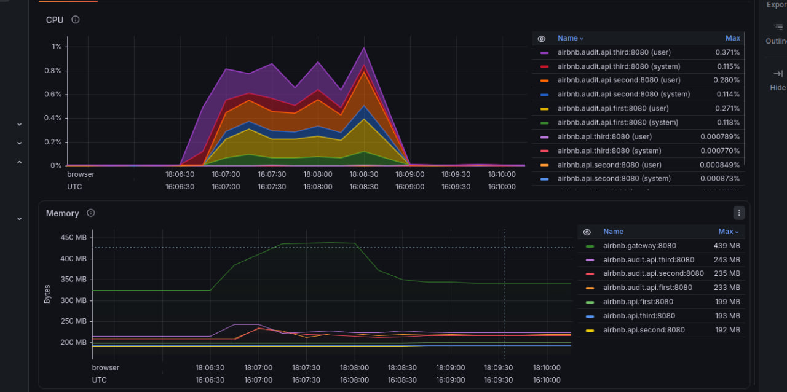
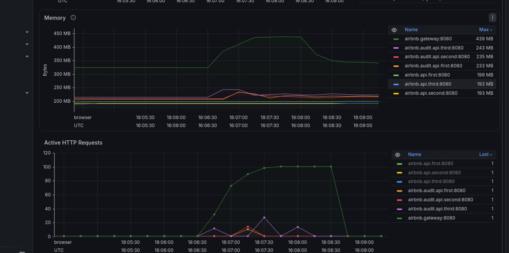

# Booking System

A learning project: an apartment booking backend built with .NET.

---

## How it works



1. All client requests go through the **Gateway** (YARP reverse proxy).
2. The Gateway routes by path:
   - `/api/audit/...` → **Audit API**
   - `/api/...` → **Main API**
3. Each API runs as 3 instances behind the Gateway, load-balanced round robin.
4. The Main API stores data in **SQL Server**. The Audit API stores data in **MongoDB**.
5. The Main API publishes domain events (user, apartment and booking changes) to **RabbitMQ**.
   The Audit API consumes them and stores the change history.



---

## Technologies

| Area | Technology |
|---|---|
| Framework | C#, .NET 10, ASP.NET Core Web API |
| API gateway | YARP (reverse proxy, round-robin load balancing) |
| Main API data access | SQL Server via Entity Framework Core and Dapper |
| Audit API data access | MongoDB via MongoDB.Driver |
| Authentication | ASP.NET Core Identity, JWT |
| Messaging | RabbitMQ with MassTransit |
| Validation & mapping | FluentValidation, Mapster |
| API docs | OpenAPI, Scalar |
| Logging | Serilog → Elasticsearch → Kibana |
| Metrics | OpenTelemetry → Prometheus → Grafana |
| Load testing | k6 |
| Unit testing | xUnit, Moq, Shouldly |
| Containers | Docker, Docker Compose |
| CI/CD | GitHub Actions → Docker Hub → AWS ECS |

---

## Running

Requires [Docker](https://docs.docker.com/get-docker/) with Docker Compose.

Configuration lives in `.env` (mock values only). Docker Compose loads it automatically.

Open a terminal in the repository root and start the stack:

```bash
docker compose up --build
```

The first start takes a few minutes (pulling images, building the services, starting
Elasticsearch). Database migrations run automatically when the Main API starts.

When you're done, press **Ctrl+C** in the same terminal, then remove the containers and the
built images:

```bash
docker compose down --rmi local
```

Volumes (database, log and metric data) are kept. See [Resetting data](#resetting-data) to remove them.

---

## Services

### APIs

| Service | URL | API docs |
|---|---|---|
| Gateway | http://localhost:3100 | — |
| Main API (instances 1–3) | http://localhost:3101, :3102, :3103 | http://localhost:3101/scalar |
| Audit API (instances 1–3) | http://localhost:3201, :3202, :3203 | http://localhost:3201/scalar |

Gateway routes:

| Gateway path | Target |
|---|---|
| `/api/auth/register`, `/api/auth/login` | Main API: registration, login (returns a JWT) |
| `/api/apartments/...`, `/api/bookings/...`, `/api/user/...` | Main API |
| `/api/audit/users/all`, `/api/audit/apartments/all`, `/api/audit/bookings/all` | Audit API |

Protected endpoints need the `Authorization: Bearer <token>` header with the token from `/api/auth/login`.

Every service exposes Prometheus metrics at `/metrics`, e.g. http://localhost:3101/metrics.

### Infrastructure

| Service | URL / host | Credentials |
|---|---|---|
| Grafana | http://localhost:4000 | `admin` / `admin` |
| Prometheus | http://localhost:9090 | — |
| Kibana | http://localhost:5601 | — |
| Elasticsearch | http://localhost:9200 | — |
| RabbitMQ management | http://localhost:2101 | `guest` / `guest` |
| SQL Server | `localhost,2000` | `sa` / `DevPassw0rd123` |
| MongoDB | `mongodb://localhost:2001` | `admin` / `DevPassw0rd123` |

---

## Testing

End-to-end check of the Main API → RabbitMQ → Audit API flow:

1. Register a user: `POST http://localhost:3100/api/auth/register`.
2. Log in: `POST http://localhost:3100/api/auth/login` and copy the token.
3. Change the email: `PUT http://localhost:3100/api/user/update/email` with the token.
4. Check the history: `GET http://localhost:3100/api/audit/users/all`. The email change should be listed.

---

## Logs (Elasticsearch + Kibana)

All services write logs to Elasticsearch through Serilog, one index per service and day:

```
airbnb.api-logs-production-YYYY.MM.DD
airbnb.audit.api-logs-production-YYYY.MM.DD
airbnb.gateway-logs-production-YYYY.MM.DD
```

To browse them, open Kibana → **Discover** → **Create a data view**. Use the index
pattern `airbnb.*` (or e.g. `airbnb.api-logs-*` for a single service) and `@timestamp` as the time field.



---

## Metrics (Prometheus + Grafana)

Prometheus scrapes `/metrics` on every service every 10 seconds (`prometheus.yml`).

Grafana setup (one time):

1. **Connections → Data sources → Add data source → Prometheus**, URL `http://prometheus:9090`.
2. **Dashboards → New → Import**, upload `Airbnb Dashboard.json` from the repository root.

### Runtime metrics

CPU, memory and active HTTP requests per instance:



### Custom metric

The Main API counts created users by email domain
(`Monolith/Airbnb.Application/Metrics/BusinessMetrics.cs`).



---

## Load testing (k6)

`load-test.js` runs 100 virtual users against the Gateway for 2 minutes. With the stack
running, start it from a second terminal:

```bash
docker compose --profile load-test run --rm k6
```

k6 is behind the `load-test` profile, so `docker compose up` doesn't start it.

Results from a test run:

#### CPU and Memory



#### Memory and Active Requests



---

## Resetting data

Remove only log and metric data:

```bash
docker compose rm -sf prometheus elasticsearch kibana
docker volume rm dotnet-mentorship_prometheus-data dotnet-mentorship_elasticsearch-data
```

Remove all data, including the databases, RabbitMQ and Grafana dashboards:

```bash
docker compose down -v
```
